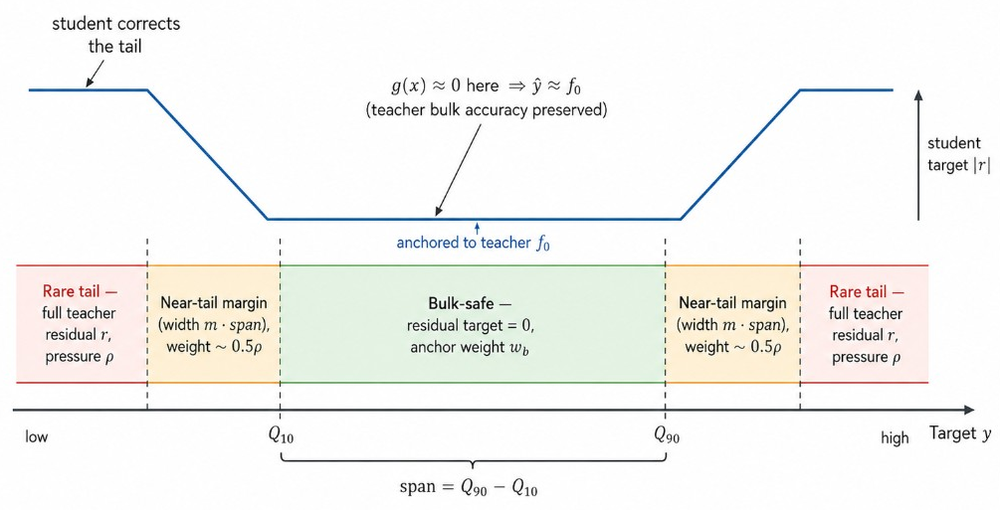
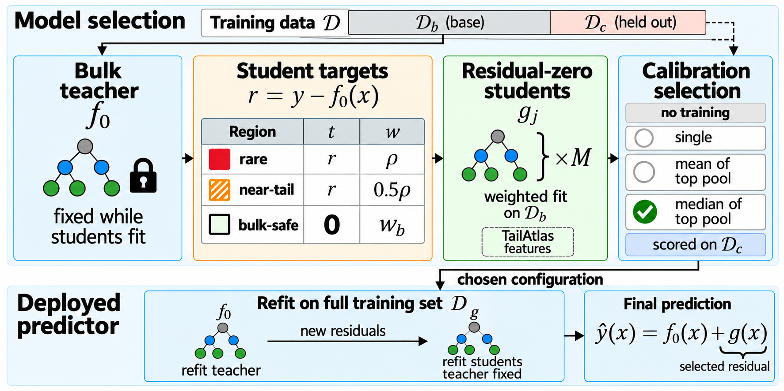
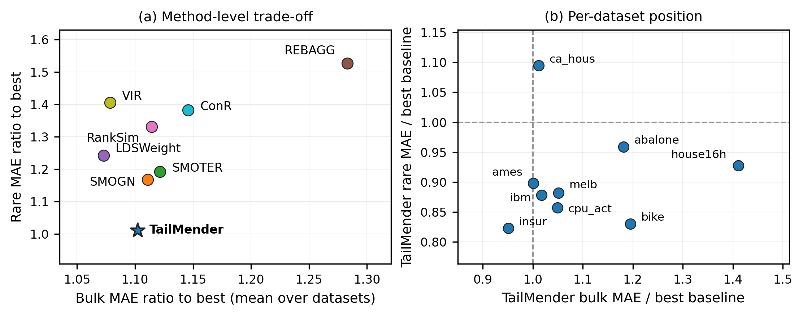

# TailMender

**When the rare band is the one that matters, a single model pulled toward the bulk starts leaving the wrong residuals behind.**

TailMender is a batch tabular method for imbalanced regression. A gradient-boosted bulk teacher fits the dense region under uniform weights. Residual-zero tail students learn the teacher's errors on rare and near-tail rows while anchoring to a zero residual on bulk-safe rows. Held-out calibration selects among pressured students; the teacher and the chosen students are then refit on the full training set. The deployed predictor adds the selected residual to the teacher mean.

<p align="center">
  <a href="#quick-start"><strong>Quick start</strong></a>
  &nbsp;·&nbsp;
  <a href="#reproduce-the-tables"><strong>Reproduce</strong></a>
  &nbsp;·&nbsp;
  <a href="#layout"><strong>Layout</strong></a>
</p>

## When the bulk wins the fit

Global oversampling, reweighting, and deep regularizers reshape one shared loss. Tail pressure then moves through the same representation that should stay accurate in the dense region. TailMender separates the two jobs.

<p align="center">
  
</p>

## Teacher fixed, then full-set refit

On the base split the teacher is held fixed while candidate students fit residual targets. Calibration scores already-fitted candidates on a held-out split with no further training. After selection, the teacher is refit on the full training set, then the selected students are refit against its new residuals.

<p align="center">
  
</p>

## Rare gain, bulk in the middle

Across nine tabular benchmarks, TailMender sits at the bottom of the rare-error axis while remaining unremarkable rather than best on the bulk axis. The trade-off is asymmetric: large rare-region gains for a moderate bulk cost concentrated on a few datasets.

<p align="center">
  
</p>

## Quick start

Python 3.10+ recommended.

```bash
pip install -r requirements.txt
python scripts/run_radical_smoke.py --profile smoke --datasets abalone --seeds 42 --n-estimators 12 --max-train 300 --max-test 120 --output-dir results/smoke
```

PowerShell:

```powershell
python scripts\run_radical_smoke.py --profile smoke --datasets abalone --seeds 42 --n-estimators 12 --max-train 300 --max-test 120 --output-dir results\smoke
```

## Reproduce the tables

Nine-dataset suite with three seeds (CPU-intensive; allow several hours):

```bash
python scripts/run_radical_smoke.py --profile full --seeds 42,43,44 --n-estimators 80 --output-dir results/full
```

Subset example:

```bash
python scripts/run_radical_smoke.py --profile full --datasets abalone,california_housing,insurance --seeds 42 --output-dir results/subset
```

Outputs go under `results/` (gitignored). Datasets download at runtime through OpenML and scikit-learn; no proprietary files are bundled.

```bash
python scripts/run_radical_smoke.py --help
```

## Layout

```
scripts/           smoke / full evaluation driver and dataset loaders
src/evaluation/    rare-region metrics
docs/figures/      motivation, framework, and results plates for this README
requirements.txt
```

## Notes

- Rare region: bottom and top 10% of training targets (fixed thresholds).
- Baselines in the driver include no-rebalance, static / inverse-density / LDS weights, random tail replay, SMOTER, SMOGN, and REBAGG, plus TailMender.
- Hyperparameters for the student grid and calibration objective live in `scripts/run_radical_smoke.py`.
- The calibration split never enters a fit that it scores; the deployed predictor uses every training row after selection.
